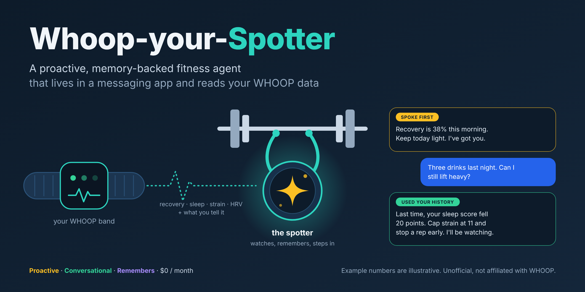
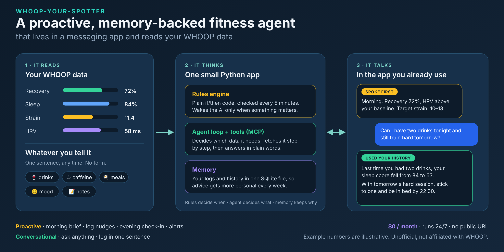
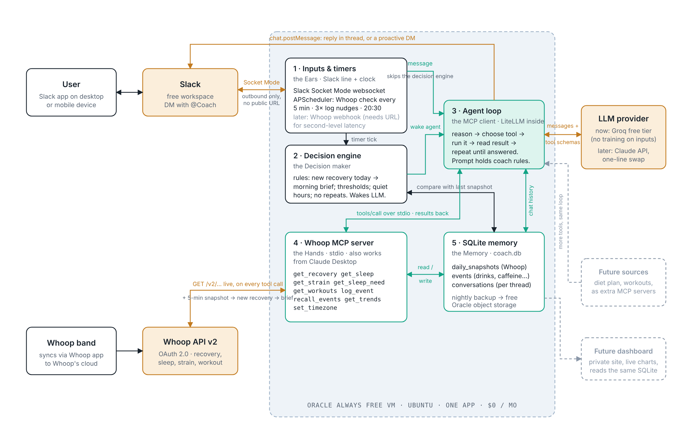

# Whoop-your-Spotter

[](docs/spotter.png)

**A proactive, memory-backed fitness agent that lives in a messaging app and reads your WHOOP data.**

> **Unofficial project. Not affiliated with, endorsed by, or sponsored by WHOOP or Slack.** "WHOOP" and "Slack" are trademarks of their respective owners and are used here only to say what this software works with.

[](https://github.com/rahulchavanrc-PM/whoop-your-spotter/actions/workflows/ci.yml)


A personal coach that lives in a Slack DM, reads your WHOOP band's recovery, sleep and strain data, remembers what you tell it, and reaches out on its own: a morning brief when recovery lands, a nudge to log a meal, an alert when strain is off, an evening check-in. Single user, $0/month, nothing listens on a port.

**Design write-up:** [Whoop-your-Spotter: interactive architecture and design walkthrough](https://claude.ai/artifact/6LSTsHVta4hzwYiq4cqBAX)

* * *

## Summary



WHOOP is good at measuring your body and bad at knowing how you actually feel. Some mornings it says 80% recovery and you feel wrecked; some days it is red and you feel fine. The only way to tell it is a once-a-day journal form with fixed questions, and those answers never seem to make it back into the advice. The result is a system that knows a lot and coaches very little. Six gaps drove this project:

- **The intake form is exhausting.** A coach should ask small questions a few times a day and accept a one-line log at any moment.
- **The data is locked in the app.** It should arrive where you already are, in a chat.
- **The app is a maze.** A plain-English question should get a plain-English answer.
- **When it speaks first, it is not coaching.** A number is not advice weighed against what you have planned.
- **It forgets.** "Last time you had two drinks, sleep fell 20 points" needs a memory of what you told it.
- **It cannot reason across sources.** "How many drinks can I have tonight and still train hard tomorrow?" needs sleep debt, today's strain and past nights together. That takes an agent that decides which data to fetch, not a dashboard.

The product is a coach in Slack that does three things. You can **log anything in a sentence** ("two glasses of wine, feeling flat, rough day"). You can **ask real questions** and get answers from your own history instead of population averages. And it **speaks first**: a brief when recovery arrives, a few nudges, an evening check-in, and an alert if something looks off.

Under the hood: an LLM agent loop that calls tools on an MCP server over the WHOOP API, a SQLite memory, and a cheap rules engine that decides when it is worth waking the model. It was built with Claude Code, with the human owning the design. The story of how, including what broke, is in [BUILD_LOG.md](BUILD_LOG.md). An interactive version of the design (clickable system map, trade-offs, FAQ) is in the [design write-up](https://claude.ai/artifact/6LSTsHVta4hzwYiq4cqBAX).

* * *

## Product Vision

The target isn't a chatbot that answers Whoop questions when asked. It's a coach that behaves like a good one: it notices things on its own, remembers what it's told, and reasons across data before it speaks — reaching out when something is worth knowing, and answering real questions by deciding, step by step, what to check. Below is one ordinary day, end to end, exactly as it would appear in Slack.


> **Note:** This mockup shows the target experience. Today the coach replies in plain text; the cards, chart, buttons, strain targets and automatic next-morning follow-up are future work.

Three proactive messages that weren't asked for, two logs that took one sentence, and one real question answered by reasoning over tool calls rather than a lookup. That's the whole pitch: **autonomy** (it decides when to speak and what to check), **memory** (it gets better at answering because it remembers), and **reach** (it lives where the user already is). Numbers shown are illustrative. _Interactive version: link coming soon._

* * *

## What it does

**Proactive messages**
- A **morning brief** the moment WHOOP computes your recovery, not on a fixed clock
- Three daily **"anything to log?" nudges** (10:30, 14:30, 18:30 local), skipped if you logged something in the last 2 hours
- An **evening check-in** (20:30 local): tonight's sleep target, today's strain, what it means for tomorrow
- **Threshold alerts** when recovery or HRV drops sharply against your own 7-day average, or strain is far off for your recovery
- **Quiet hours** (23:00 to 07:00 local) and **no-repeat**, so proactive does not become a nag

**Conversational**
- **Ask anything** in plain English (recovery, sleep, strain, trends); the coach fetches only the data the question needs
- **Log anything in one sentence** ("double espresso and two eggs at 10"). Each thing becomes a timestamped event, and a stated feeling ("feeling alert and dialed in") is logged as its own **mood** event, so the coach learns how you felt, not only what you did

**Memory**
- Events, daily snapshots and conversation history are stored in one SQLite file, so advice gets more personal every week. Ask "did that late coffee affect my recovery?" and it joins your logged coffee to the next morning's recovery

**Time zone**
- Follows the zone in your Slack profile (read every tick). Say "I'm in Tokyo this week" and the `set_timezone` tool overrides it until you say you are back

**Future scope** (each plugs into the existing loop): instant alerts via WHOOP webhooks (needs a public URL), diet-aware targets, extra MCP servers (diet plan, workout schedule), a **historical backfill** at setup (pull past WHOOP recoveries, sleeps and cycles into the memory so the coach can cite your history from day one), a **weekly report** plus a private dashboard (for example a Streamlit app) reading the same SQLite file, and a stronger model (one model-string change via LiteLLM).

* * *

## Architecture



One small app on an always-on machine, five parts inside it, three outside services. Nothing listens on a port: Slack, WHOOP and the LLM provider are all reached by dialing out.

1. **Inputs and timers** (`coach/app.py`): a Slack Socket Mode listener (an outbound websocket) and a 5-minute scheduler.
2. **Decision engine** (`coach/rules.py`): plain `if`/`then` code on the timer. Decides whether to wake the AI at all (brief, nudge, check-in, alert), and respects quiet hours and no-repeat. A direct message skips it and goes straight to the agent.
3. **Agent loop** (`coach/agent.py`): an MCP client plus LiteLLM. Sends the conversation and tool list to the model, runs the tools it asks for, repeats until it answers in words.
4. **WHOOP MCP server** (`coach/mcp_server.py`): 9 tools, run as a child process over stdio. Calls the WHOOP API live and reads and writes SQLite.
5. **SQLite memory** (`coach/db.py`): `coach.db` with four tables: `daily_snapshots`, `events`, `conversations`, `settings`.

Three seams keep it swappable: WHOOP details live only in `whoop.py` and `mcp_server.py`; the LLM only behind LiteLLM in `agent.py`; Slack only in `app.py` and one `send()` helper. For a clickable version of this diagram, with a flip card for each part, see the [design write-up](https://claude.ai/artifact/6LSTsHVta4hzwYiq4cqBAX).

**What happens when you ask "Can I drink tonight?"** The model is never handed your data up front. It is handed a list of tools and decides what it needs: today's recovery and sleep need first, then today's strain, then what happened the last few times you logged a drink (`recall_events`). With that it writes an answer that cites your own history. The reply is posted to Slack and the exchange is saved.

**The 9 MCP tools**

| Tool | Arguments | Returns |
|---|---|---|
| `get_recovery` | `date="today"` | recovery %, HRV, resting heart rate |
| `get_sleep` | `date="today"` | performance %, hours, stages, efficiency |
| `get_strain` | `date="today"` | day strain, average heart rate, workout count |
| `get_sleep_need` | none | tonight's sleep need, with baseline, debt and strain parts |
| `get_workouts` | `days=7` | recent workouts: sport, start, duration, strain |
| `log_event` | `kind, note, at?` | the stored event (kind: alcohol, caffeine, food, note, mood, other) |
| `recall_events` | `kind?, days=30` | logged events, each with the next morning's recovery and sleep |
| `get_trends` | `days=14` | daily rows: recovery, HRV, sleep performance, strain |
| `set_timezone` | `tz_name` | sets or clears (`"auto"`) the manual time-zone override |

Times you give are local wall-clock; the server converts to UTC for storage and back, so the model never does time-zone arithmetic.

* * *

## Stack

| Layer | Tool | Monthly cost |
|---|---|---|
| Language | Python 3.11+ | $0 |
| Chat interface | Slack app via Slack Bolt, Socket Mode | $0 |
| Data source | WHOOP API v2 (OAuth 2.0) | $0 |
| Tool layer | MCP server and client (`mcp`) | $0 |
| AI | Groq free tier via LiteLLM (model string in `coach/config.py`) | $0 |
| Memory | SQLite (WAL mode) | $0 |
| Scheduler | APScheduler | $0 |
| Hosting (optional, 24/7) | systemd on an Oracle VM (Always Free) | $0 |

* * *

## Local setup

You need Python 3.11+, a Slack workspace you can add apps to, a WHOOP account with a band, and about 20 minutes.

### 1. Clone and install

```bash
git clone https://github.com/rahulchavanrc-PM/whoop-your-spotter.git
cd whoop-your-spotter
python3.11 -m venv venv
source venv/bin/activate
pip install -r requirements.lock   # exact pinned versions; requirements.txt lists what the project needs directly
cp .env.example .env               # you will fill this in over the next steps
```

### 2. Create the Slack app

1. Go to [api.slack.com/apps](https://api.slack.com/apps), choose **Create New App**, then **From scratch**, and pick your workspace.
2. **Socket Mode**: turn it on. When asked, create an app-level token with the `connections:write` scope. Copy it (starts `xapp-`) into `SLACK_APP_TOKEN` in `.env`.
3. **OAuth & Permissions**, bot token scopes: `chat:write`, `im:history`, `im:read`, `im:write`, `users:read`.
4. **Event Subscriptions**: turn on, and under *Subscribe to bot events* add `message.im`.
5. **App Home**: turn on the **Messages Tab** and tick **Allow users to send Slash commands and messages from the messages tab**.
6. **Install to Workspace**. Copy the **Bot User OAuth Token** (starts `xoxb-`) into `SLACK_BOT_TOKEN`.
7. Your own Slack user ID: in Slack, open your profile, choose the three-dots menu, then **Copy member ID** (starts `U`). Put it in `SLACK_USER_ID`. This is who the coach messages first.

### 3. Get a Groq key

Create an API key at [console.groq.com](https://console.groq.com) and put it in `GROQ_API_KEY`. The free tier is enough, and Groq states it does not train on API inputs.

### 4. Create the WHOOP app and authorize it

1. At [developer.whoop.com](https://developer.whoop.com), create an app. Set the redirect URI to exactly `http://localhost:8765/callback` and request the scopes `read:recovery read:cycles read:sleep read:workout read:profile read:body_measurement offline`.
2. Put the app's client ID and secret in `WHOOP_CLIENT_ID` and `WHOOP_CLIENT_SECRET`.
3. Run the one-time authorization. It opens your browser, catches the redirect on a tiny local server, and writes `WHOOP_REFRESH_TOKEN` into `.env`:

```bash
python scripts/whoop_auth.py
```

### 5. Test and run

```bash
pytest                    # fast, offline
python -m coach.app       # starts the coach; leave it running
```

Look for `coach is listening on Socket Mode`, then DM the app in Slack. Try:

- "What was my recovery this morning?"
- "Double espresso at 10, feeling sharp" (logs a caffeine event and a mood event)
- "I'm in Tokyo this week" (sets the time-zone override)
- "Did coffee affect my recovery?" (after a few days of logs)

The coach checks WHOOP every 5 minutes and logs one line per check (`tick ok: ...`), so you can see it working.

* * *

## Environment variables

All live in `.env` (git-ignored).

| Variable | What it is | Where to get it | Required |
|---|---|---|---|
| `SLACK_BOT_TOKEN` | Bot token, starts `xoxb-` | Slack app, Install to Workspace | Yes |
| `SLACK_APP_TOKEN` | App-level token for Socket Mode, starts `xapp-` | Slack app, Socket Mode | Yes |
| `SLACK_USER_ID` | Your Slack member ID, starts `U`; the coach DMs you | Slack profile, Copy member ID | Yes |
| `GROQ_API_KEY` | AI provider key, read by LiteLLM | console.groq.com | Yes |
| `WHOOP_CLIENT_ID` | WHOOP app client ID | developer.whoop.com | Yes |
| `WHOOP_CLIENT_SECRET` | WHOOP app client secret | developer.whoop.com | Yes |
| `WHOOP_REFRESH_TOKEN` | Written by `scripts/whoop_auth.py`; rotated automatically afterwards | Run the script | Yes (after step 4) |
| `BACKUP_PAR_URL` | Write-only link for the nightly database backup | See `deploy/README.md` | Optional |

* * *

## Deployment (optional, 24/7)

Running on your laptop works, but the coach only reaches you while it is awake. For always-on use, the repo includes a systemd unit, a nightly-backup timer and a step-by-step guide for an Oracle VM (Always Free): [deploy/README.md](deploy/README.md).

Why it is simple: nothing listens on a port, so there is no domain, no TLS certificate and no firewall opening beyond SSH. The database is one file, backed up nightly through a write-only link, so the VM holds no cloud credentials.

**One warning:** WHOOP's refresh token is single-use and rotates on every refresh, and the app keeps the current one in `.env`. Run the coach on **one machine at a time**. A second copy (a laptop plus a VM, for example) will invalidate the first.

* * *

## Privacy and data

This app handles health data, so here is exactly where it goes.

- **On your machine:** your logs, daily WHOOP snapshots, conversation history and settings live in one SQLite file, `coach.db`, on the machine running the app. Your secrets live only in `.env`. Both are git-ignored and never leave the machine, except for the optional nightly backup, which uploads `coach.db` to a bucket you own.
- **To WHOOP:** the app reads your recovery, sleep, strain and workout data from WHOOP's API with your own authorization. It requests read-only scopes and never writes to your WHOOP account.
- **To the AI provider:** to answer, the text of your messages and the WHOOP numbers and logged events the model asks for are sent to the provider behind LiteLLM (Groq by default). Groq states that it does not train on API inputs; check the current terms of whichever provider you use. If you change `MODEL`, you change where this data goes.
- **To Slack:** your messages and the coach's replies are ordinary Slack DMs, so they are visible to your Slack workspace under its normal retention rules.
- **Exposure:** nothing listens on a port, so there is no public endpoint to attack. The app connects outward only, to Slack, WHOOP and the AI provider.
- **No tracking:** this project adds no analytics or telemetry of its own.
- **Not medical advice:** the coach is an AI that can be wrong.

* * *

## Personalisation

- **Persona and coaching rules:** the system prompt in `coach/agent.py`.
- **Schedule, quiet hours, thresholds:** constants at the top of `coach/rules.py` (`NUDGE_SLOTS`, `CHECKIN_SLOT`, `QUIET_START_HOUR`, `QUIET_END_HOUR`, `RECOVERY_DROP_RATIO`, `HRV_DROP_RATIO`, `HIGH_STRAIN`).
- **Model:** the `MODEL` string in `coach/config.py` (any LiteLLM model that supports tool calling).
- **Time zone:** follows your Slack profile; override by chatting, or set `tz_override` in the `settings` table.

* * *

## Trade-offs

Every decision had at least one credible alternative. Revisit a row when the constraint behind it changes.

| Decision | Chose | Why |
|---|---|---|
| Chat interface | Slack | Free proactive (bot-initiated) messages. Proactivity is the product. |
| Where it runs | An always-on VM (Oracle Always Free) | A real always-on machine at $0. Serverless free tiers sleep or wipe their disk, which would lose WHOOP's rotating refresh token. |
| Memory | SQLite file | Fewest moving parts: one file, no network hops, simple backup. |
| LLM | Groq free tier now, Claude later | $0 and no training on inputs. LiteLLM makes the swap a one-line change. |
| Language | Python | Readable when something breaks at 11pm. |
| Slack delivery | Socket Mode | Real-time with zero inbound setup: no domain, no TLS, no open port. |
| WHOOP freshness | 5-minute polling | Simplicity and resilience over seconds of latency; recovery is a once-a-day number, and polling survives a missed event. |
| Morning brief trigger | Event-driven | Fires when WHOOP actually computes recovery, matching real wake time, at no extra cost. |
| WHOOP access | MCP server | The same tools can serve Claude Desktop, a dashboard or a second bot. |
| Who wakes the LLM | Rules first | Cost control and predictability; quiet hours and thresholds are better as plain code. |
| Structure | One app | One thing to deploy, one log to read. |
| Time zone | The user's, not the server's | Correctness over a simpler fixed schedule. |

* * *

## Known limitations

- **No step count.** WHOOP's API v2 does not expose one.
- **WHOOP dates are wake-to-wake cycles, not calendar days.** A cycle runs from one sleep onset to the next. The date tools resolve a date to the cycle containing that local day's midday and return a `cycle_id`; two dates can occasionally return the same record, and the coach says so instead of reusing another day's numbers.
- **The time-zone override has no expiry.** It stays until you say you are back.
- **Single user, single machine.** One SQLite file, one WHOOP account, by design.
- **Free-tier AI rate limits.** The agent retries with growing waits, then says the provider is busy; a proactive message that fails to send stays due and is retried.
- **Cloud idle policies.** Free VMs can be reclaimed if they look idle for long enough. This app is mostly idle by design; watch your VM.
- **No external liveness check.** `systemd` restarts a crashed process, but nothing outside the machine alerts if the whole machine goes dark.

* * *

## FAQ

- **Why an "agent loop" between the script and the LLM?** The LLM is a brain in a sealed room: text in, text out, nothing remembered, nothing it can fetch. The loop hears "I need the recovery score first," runs the tool, brings the result back, and repeats until the model answers in words.
- **Why an MCP server instead of calling the WHOOP API directly?** A function trapped inside the bot file cannot be reused. A tool on an MCP server can serve other clients later, for about 30 extra lines.
- **If nothing accepts inbound traffic, how does it react to a strain spike?** By asking, not being told: a 5-minute poll writes a snapshot and the rules compare it with the 7-day pattern. A webhook would cut the lag to seconds at the cost of a public URL.
- **Why Groq and not Gemini's free tier?** The constraint was $0, and Groq's free tier states it does not train on inputs, which matters for health data. Claude is the intended upgrade for stronger reasoning.
- **Why does the refresh token need so much care?** WHOOP retires a refresh token the moment it is used and returns a new one, and refreshing also retires the previous access token. `coach/whoop.py` re-reads the token under a file lock on every refresh, shares the current access token between processes, and retries once on a 401. The story is in [BUILD_LOG.md](BUILD_LOG.md).

* * *

## Repo layout

```
coach/       application package (config, db, whoop, mcp_server, agent, rules, backup, app)
scripts/     one-time WHOOP authorization; Claude Desktop config example
deploy/      systemd units (coach + nightly backup), deploy guide, memory-check scripts
docs/        README images
tests/       unit tests (fast, no network)
```

## License

[MIT](LICENSE). Copyright (c) 2026 rahulchavanrc-PM.

## Disclaimer

Whoop-your-Spotter is an independent, unofficial project. It is **not affiliated with, endorsed by, or sponsored by WHOOP, Inc. or Slack Technologies**. "WHOOP" and "Slack" are trademarks of their respective owners; no WHOOP logos or product artwork are used, and the names appear only to describe what this software works with. It is also not related to other products or projects called "Spotter". This is not medical advice, and the coach is an AI that can be wrong: it is a personal experiment, not a substitute for a doctor or a qualified trainer. Use it with your own WHOOP data and accounts, and at your own risk.
